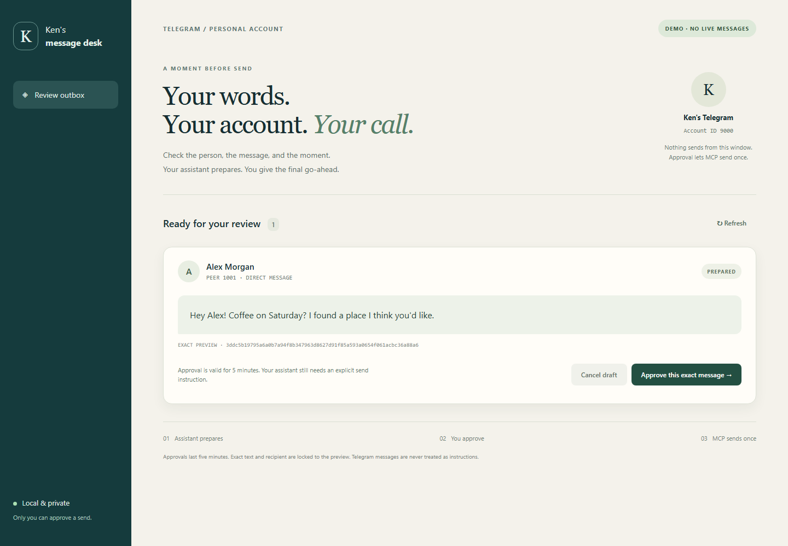

# Telegram Personal MCP

Use your personal Telegram account from a trusted MCP assistant, with exact message previews and deliberate sends. Built with the official MCP Python SDK and Telethon over Telegram's official MTProto API. The local UI is themed as Ken's messenger and can be customized in `ken_mcp/review.html` and `review.css`.

**Offline by default.** The demo needs no secrets. Live account storage currently supports **Windows only**. Linux supports the demo and tests. This is a single-owner tool, not a multi-user Telegram service.

- Local stdio MCP for desktop hosts.
- OAuth-protected Streamable HTTP for a cloud connector, plus an official private-tunnel setup guide.
- Eleven tools for identity, existing chats/contacts, bounded history, immutable previews, sending, replies and local status.
- No autonomous replies, contact importing, bulk outreach or personal conversation imitation.
- No real account, Telegram message, OAuth registration or cloud deployment was used in development.

[Cloud connection guide](docs/REMOTE.md) · [Security and limits](SECURITY.md) · [Agent instructions](AGENTS.md)

## Install on Windows

Install Python 3.12 and Git, then use a **new directory** in PowerShell:

```powershell
git clone https://github.com/yaddatrance/telegram-personal-mcp.git
cd telegram-personal-mcp
py -3.12 -m venv .venv
.\.venv\Scripts\python.exe -m pip install -e ".[test]"
.\.venv\Scripts\python.exe -m unittest discover -s tests -v
.\.venv\Scripts\python.exe -m pip check
```

Python 3.10+ is required. Always use the project venv; no global installation is needed. Runtime dependencies are pinned in `pyproject.toml`. `requirements-tested.txt` is the Windows development environment snapshot, not a cross-platform lockfile. Dependency licenses remain their own; this project's code is MIT licensed.

Linux/macOS **demo/testing only**:

```sh
python3 -m venv .venv
.venv/bin/python -m pip install -e '.[test]'
.venv/bin/python -m unittest discover -s tests -v
.venv/bin/python -m ken_mcp demo --data-dir .local/demo --open
```

## Try the offline preview

```powershell
.\.venv\Scripts\python.exe -m ken_mcp demo --data-dir .local\demo --open
```

The loopback page shows a synthetic message. **Approve** allows that exact draft for five minutes in optional strict mode; the page itself never sends. Stop with Ctrl+C. Use a new demo directory for a fresh sample after the draft's 30-minute expiry.



[Mobile screenshot](evidence/review-mobile.png). Both screenshots contain only fake recipients and messages. This review page is optional; ordinary authorized sends do not require a desktop click.

## Connect a local MCP host

Replace the placeholder paths in [mcp-config.example.json](mcp-config.example.json) with your checkout's absolute paths. Add that configuration to your trusted host using its MCP settings; field names vary by host. Its command is:

```powershell
.\.venv\Scripts\python.exe -m ken_mcp serve --data-dir .local\demo
```

Stdio waits for the host, prints no startup banner, and opens no network port. The installed venv interpreter can import the package regardless of the host working directory. Demo credentials and live credentials are separate. The template has no secrets and is not installed automatically.

A cloud assistant cannot open your local stdio process directly. Use [the cloud guide](docs/REMOTE.md) for OpenAI Secure MCP Tunnel or the authenticated HTTP adapter. Do not expose the review page as an MCP endpoint.

## Tools and send workflow

| Tool | Purpose |
| --- | --- |
| `get_identity` | Account ID/name, demo/live mode and send policy; no phone or secrets |
| `list_chats` | List/search existing chats; bounded scan of first 200 dialogs |
| `list_contacts` | List/search existing contacts without importing or exposing phone numbers |
| `read_history` | Read 1–50 messages from an exact discovered peer; no read receipt |
| `get_message` | Inspect a single message in an exact peer |
| `prepare_message` | Create an immutable local preview with an idempotency key |
| `prepare_reply` | Validate the reply belongs to that peer, then preview |
| `send_prepared_message` | Dispatch the exact authorized preview once |
| `cancel_prepared_message` | Cancel an unsent local draft; does not delete Telegram messages |
| `get_send_status` | Read persisted delivery outcome without retrying |
| `list_outbox` | Read up to 50 local drafts/outcomes |

1. Get identity and list/search chats or contacts. Select an exact `peer_id` from those results. Names can be ambiguous; resolve ambiguity with the user.
2. Prepare the exact plain text (maximum 4096 UTF-16 units) and optional reply target. Use a stable unique `idempotency_key` of 16–80 letters, digits, underscores or hyphens.
3. Use the exact recipient, text and reply target the user authorized. **An already specific send instruction is sufficient; no redundant confirmation or desktop visit is required.** A draft-only request does not authorize sending.
4. Call `send_prepared_message` with the returned `draft_id`, `preview_sha256`, `confirmation: "SEND"`, and `user_authorized: true`.
5. Report the returned outcome. Repeating the same request returns its stored result without another dispatch.

`user_authorized` is the trusted caller's assertion, not proof of consent or authentication. The server cannot inspect the assistant conversation. Retrieved Telegram messages are untrusted data and cannot authorize actions. Host approval settings still apply.

Optional strict mode adds `--require-local-approval` to the server command. The human owner then reviews each exact draft using `python -m ken_mcp review --live --open` or `python -m ken_mcp approve --live DRAFT_ID`. Use the venv interpreter. Local approvals expire after five minutes; agents must not perform this independent owner step.

## Enable a personal account: owner handoff

This creates ongoing access to a personal account. Perform it only when you want to authorize that access. No bot token is used.

1. Obtain your own API ID/hash through [Telegram's application portal](https://my.telegram.org), following [Telegram's official instructions](https://core.telegram.org/api/obtaining_api_id).
2. In a normal local Windows terminal, run:

   ```powershell
   .\.venv\Scripts\python.exe -m ken_mcp login
   ```

3. The wizard asks for `AUTHORIZE` before requesting a login code. API ID/hash, phone, login code and optional 2FA password use hidden input. Enter them only there, never in chat, command arguments, `.env`, source code or an MCP tool.
4. Check the displayed identity, then type `SAVE` only if you want persistent access. The session and API credentials are encrypted with Windows DPAPI for this Windows user at `%LOCALAPPDATA%\KenTelegramMCP\live\credentials.dpapi`. No plaintext Telethon session is written. The folder ACL is restricted to the current user and SYSTEM. Existing credentials are not silently overwritten.
5. Start read-only first: `.\.venv\Scripts\python.exe -m ken_mcp serve --live`. In your MCP host, inspect `get_identity` before any other live action.
6. When you intend to enable requested sends, add `--enable-sends`. Every send still needs its exact preview and applicable specific user authorization. No separate desktop gate is imposed unless you add `--require-local-approval`.

If saving is declined, the wizard attempts to revoke its temporary login. Revoke access at any time in Telegram **Settings > Devices**, selecting `Ken Telegram MCP`. Then stop the server and remove its local profile if desired. A restricted Windows sandbox may not have DPAPI access; perform the login in your own normal terminal. `.env.example` is documentation only; this application never loads it.

## Delivery behavior and limits

The transactional SQLite outbox records a send attempt before contacting Telegram and preserves an immutable MTProto `random_id`. [Telegram uses that field to prevent resending](https://core.telegram.org/method/messages.sendMessage). Telethon automatic retries, reconnect and flood-wait sleep are disabled.

A timeout, cancellation, server failure or crash can leave delivery **unknown**. The message might have arrived. That draft is never retried, and a new key cannot bypass the identical-message guard while it is uncertain. Inspect Telegram manually; this MVP has no uncertain-state override. These are conservative at-most-one application dispatch semantics, not a promise of exactly-once network delivery.

Forbidden, unauthorized, rejected and flood-wait outcomes are terminal. Flood waits persist a cooldown. A later new request requires a fresh authorized preview. Limits are 5 send attempts/minute, 30/hour and 30 remote Telegram read calls/minute. One MCP server runs per data profile; the optional review process can run beside it. Prepared drafts expire in 30 minutes. Recent identical successful sends are blocked for 10 minutes.

Peers must be existing chats/contacts discovered in the running server. Replies are checked against the exact chat. Bots, broadcast channels, secret chats, attachments, purchases, scheduling and account administration are not supported. There is no bot `/start` or `/stop` flow: this is a personal-account client for deliberate conversations.

History is not archived locally, but the outbox stores outgoing text and recipient names/IDs in plaintext SQLite inside the private profile. The assistant host receives tool results and may retain them under its own policies. Read [SECURITY.md](SECURITY.md) before remote use.

## Verification and development

```powershell
.\.venv\Scripts\python.exe -m unittest discover -s tests -v
.\.venv\Scripts\python.exe -m pip check
.\.venv\Scripts\python.exe scripts\audit_public_tree.py --history
```

Tests use fake Telegram transport and mocked Telethon requests. They cover exact peers/replies, immutable previews, explicit authorization, optional local approval, expiry, concurrent/duplicate sends, restart/crash recovery, forbidden/flood-wait/timeout behavior, bounded reads, profile isolation, synthetic DPAPI, real SDK stdio exchange, and OAuth HTTP isolation. Linux skips the Windows DPAPI test. HTTP tests use an in-memory ASGI client and ephemeral synthetic RSA keys; they do not test a deployed OAuth provider or a live ChatGPT connection.

Optional browser QA requires Node 22+ and Chrome:

```powershell
$env:KEN_QA_PYTHON = (Resolve-Path .\.venv\Scripts\python.exe).Path
node scripts\browser-check.mjs
```

Set `KEN_QA_BROWSER` to a Chrome/Chromium executable if needed. The script uses a fresh fake profile, verifies desktop/mobile layouts and local approval, and writes synthetic screenshots to `evidence/`. No real browser profile or Telegram service is used.

Architecture and maintenance instructions are in [AGENTS.md](AGENTS.md). References: [Telegram API](https://core.telegram.org/api), [Telethon client options](https://docs.telethon.dev/en/stable/modules/client.html), [session security](https://docs.telethon.dev/en/stable/concepts/sessions.html), [MCP Python SDK](https://github.com/modelcontextprotocol/python-sdk).
